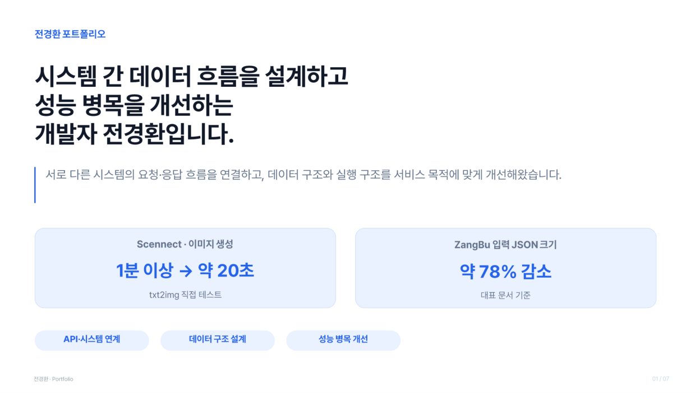

# Backend Developer Portfolio

> **시스템 간 데이터 흐름을 연결하고, 데이터 구조와 처리 구조를 서비스 목적에 맞게 개선하는 백엔드 개발자**

### 📄 [포트폴리오 PDF 열어보기](./Backend_Portfolio.pdf)

전체 **7페이지**이며, ZangBu와 Scennect에서 담당한 역할, 시스템 구성, 문제 해결 과정, 측정 결과를 정리했습니다.

## 주요 프로젝트

### 1. ZangBu | 부동산 안전 도우미

- **담당:** 공문서 API 연동 및 데이터 처리, 저장 구조 구현, Gemini 기반 AI 분석 리포트 API
- **데이터 설계:** 공문서의 중첩 JSON 원문은 MongoDB에, 사용자 및 문서 메타데이터는 MySQL에 저장하도록 역할 분리
- **데이터 검증:** 전입일 누락, 주소 검색 실패 및 중복 이력 등 예외 상황 처리
- **분석 입력 최적화:** 계약 위험 판단에 필요한 정보만 선별해 분석용 JSON 재구성. 대표 문서 기준 **JSON 문자열 길이 14,251자 → 3,080자(약 78.4% 감소)**
- **사용 기술:** Java, Spring Framework, MyBatis, MySQL, MongoDB, Gemini API, NCP Object Storage

[프로젝트 소스코드 보기](https://github.com/JJ-HMFIC/zangBu_Back)

### 2. Scennect | 협업형 AI 이미지 생성 서비스

- **담당:** Spring 서버와 FastAPI 기반 이미지 생성 API 연동, 이미지 생성 결과 처리
- **구조 변경:** 모델 관리와 GPU 추론은 Stable Diffusion WebUI API 서버로 분리하고, FastAPI는 요청·응답 처리, API 호출 및 S3 저장 담당
- **검증:** WebUI 전환과 모델·추론 설정 변경을 함께 적용한 txt2img 직접 테스트에서 **생성 시간 1분 이상 → 약 20초** 확인
- **사용 기술:** Python, FastAPI, Stable Diffusion WebUI, AWS S3, Gemini API

[프로젝트 소스코드 보기](https://github.com/JJ-HMFIC/Scennect)

## 기술 경험

`Java` `Spring` `MyBatis` `MySQL` `MongoDB` `Python` `FastAPI` `REST API` `Git`

---

**포트폴리오 원문:** [Backend_Portfolio.pdf](./Backend_Portfolio.pdf)  
**내용 기준:** 첨부된 포트폴리오 PDF의 실제 기여 및 측정 내용
